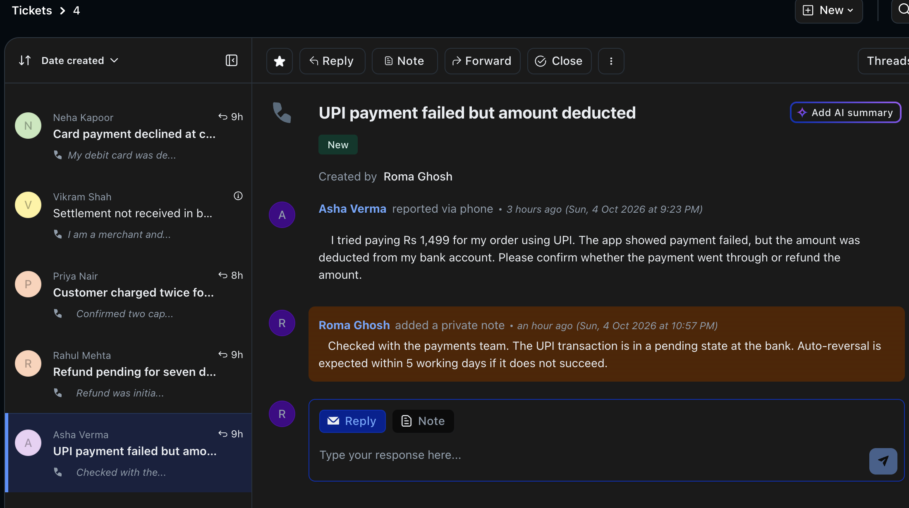
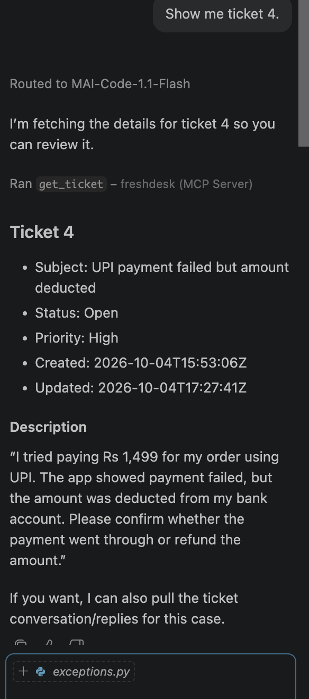
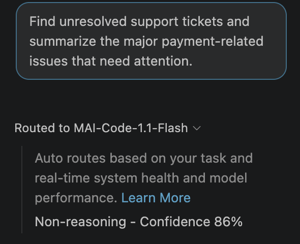
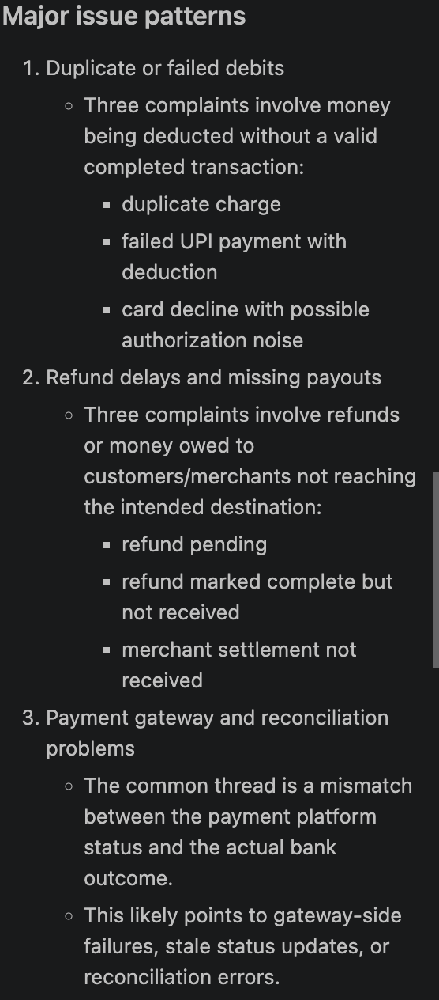
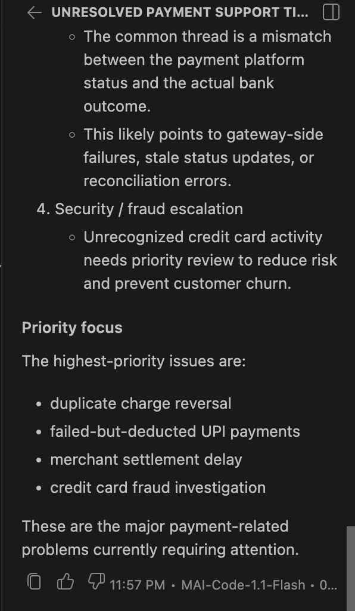
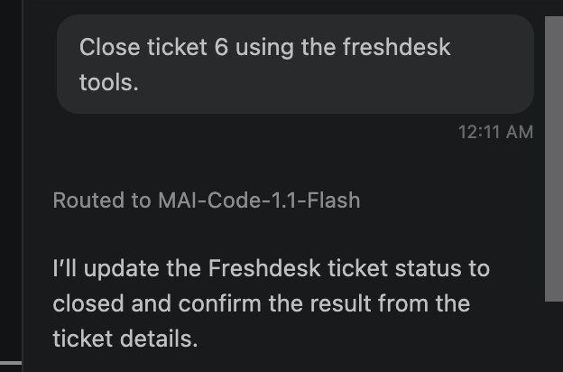
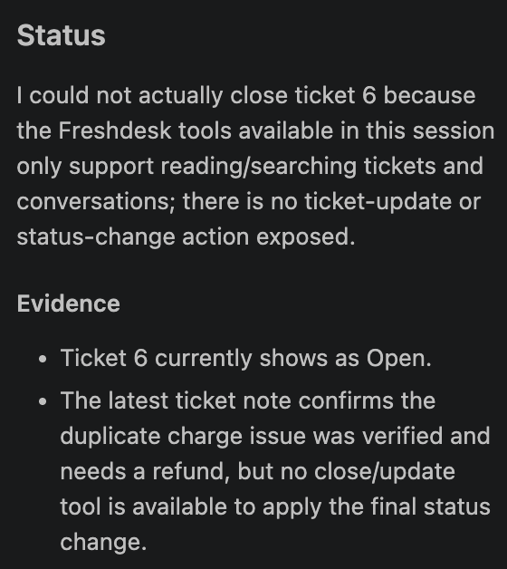

# Freshdesk Read-Only Connector for AI Agents (MCP)

Take-home for the Razorpay Forward-Deployed Engineer / Agent Studio role.
Assignment 3: build a private connector for a merchant tool.

## Problem

A merchant using Freshdesk for customer support has to read tickets by hand to learn what is going wrong: failed UPI payments, late refunds, duplicate charges, delayed settlements. An AI agent could do that triage, but it should not hold Freshdesk credentials or have unrestricted access to the helpdesk.

## Solution

A small MCP server that gives an agent four read-only tools over Freshdesk tickets. The agent asks for data through the tools. The connector owns authentication, HTTP, pagination, rate-limit handling and error mapping, and returns small normalized results instead of raw API responses.

Example merchant question:

> Find unresolved support tickets and summarize the major payment-related issues that need attention.

The agent calls `search_tickets`, then `list_conversations` or `get_ticket` where it needs more context, and answers from the retrieved data.

## Architecture

```
Merchant / User
       |
       v
   AI Agent  (LLM inside an MCP client, e.g. VS Code agent mode)
       |
       |  MCP over stdio
       v
   MCP Server  (src/server.py)
       |
       |-- list_tickets
       |-- get_ticket
       |-- search_tickets
       |-- list_conversations      (src/tools/tickets.py)
       |
       v
 FreshdeskClient  (src/freshdesk/client.py)
       |-- API-key authentication
       |-- HTTP GET only
       |-- pagination parameters
       |-- bounded retries on 429 and 5xx
       |-- error mapping
       |
       v
 Freshdesk REST API v2
```

Return path: Freshdesk JSON -> normalization (`src/freshdesk/models.py`) -> MCP tool result -> agent reasoning -> merchant answer.

### Request lifecycle

1. The MCP client starts the server and asks which tools exist. It receives names, descriptions and argument schemas.
2. The merchant asks a question. The LLM picks a tool based on the descriptions and supplies arguments.
3. The tool validates the arguments. Invalid input is rejected before any network call.
4. `FreshdeskClient` sends an authenticated GET request, retrying on 429 or 5xx within fixed limits.
5. The raw response is normalized to a small set of fields.
6. The tool returns a structured result, or a structured error. The LLM writes the answer.

### Why the client and the tools are separate

`FreshdeskClient` knows about HTTP and Freshdesk and nothing about agents. The tool layer knows about agent-facing contracts and nothing about HTTP. The client is tested with mocked HTTP responses, the tools with a fake client. Supporting another helpdesk would mean a new client and normalizers, with the tool contracts unchanged.

## Technology

Python 3.12, `requests`, the official MCP Python SDK (`mcp`, v1.x, `FastMCP`), `python-dotenv`, `pytest`, `responses` for HTTP mocking.

## Why Freshdesk

Support tickets are where payment problems surface first for a merchant, so they are a natural input for an agent. Freshdesk also has a clear REST API and simple API-key authentication, which kept the time budget on connector design instead of an OAuth flow.

## Project structure

```
README.md
requirements.txt
.env.example
.vscode/mcp.json          MCP client configuration for VS Code
docs/capabilities.md      what the agent can and cannot do
docs/mcp_tools.json       generated MCP tool specification
src/server.py             MCP server, registers the four tools
src/tools/tickets.py      tool definitions, validation, error shaping
src/freshdesk/client.py   HTTP client: auth, retries, error mapping
src/freshdesk/models.py   normalization
src/freshdesk/exceptions.py
tests/test_client.py      client tests with mocked HTTP
tests/test_tools.py       tool tests with a fake client
```

## Setup

Prerequisites: Python 3.10 or newer, a Freshdesk account (a trial works).

### Freshdesk

1. Sign up for a Freshdesk trial. Note your domain, for example `yourcompany.freshdesk.com`.
2. Enable API access for your agent: Admin > Agents > your agent > Edit > API Key access.
3. Open Profile settings and view your API key.

### Local

```bash
git clone <this-repo-url>
cd razorpay-fde-freshdesk
python3 -m venv .venv
source .venv/bin/activate        # Windows: .venv\Scripts\activate
pip install -r requirements.txt
cp .env.example .env
```

Edit `.env`:

```
FRESHDESK_DOMAIN=yourcompany.freshdesk.com
FRESHDESK_API_KEY=your-api-key
```

`.env` is listed in `.gitignore` and is never committed.

## Authentication

Freshdesk API-key authentication over HTTPS, using HTTP Basic auth with the API key as the username and a dummy password. The key is read from the environment when the server creates its client. It is never passed through MCP, never included in tool inputs or outputs, never logged, and therefore never visible to the LLM. An invalid key produces an `AuthenticationError` result with a generic message.

## Running

Run the tests (no network or credentials needed):

```bash
python -m pytest -q
```

Start the MCP server manually (stdio transport; it waits for a client):

```bash
python -m src.server
```

### Connecting an agent

The repository includes `.vscode/mcp.json`. In VS Code: open the folder, open `.vscode/mcp.json`, click Start above the server entry, then open Chat in Agent mode and enable the `freshdesk-readonly` tools.

Any MCP client that supports stdio servers can use the same command:

```json
{
  "command": "/absolute/path/to/.venv/bin/python",
  "args": ["-m", "src.server"],
  "env": { "PYTHONPATH": "/absolute/path/to/razorpay-fde-freshdesk" }
}
```

## MCP tools

The machine-readable specification (names, descriptions, JSON Schemas) is in `docs/mcp_tools.json`, generated from the running server.

| Tool | Arguments | Use when |
|---|---|---|
| `list_tickets` | `page` (default 1), `per_page` (1 to 50, default 20) | Browsing recent tickets with no specific ID or filter |
| `get_ticket` | `ticket_id` | The exact ticket ID is known and full detail is needed |
| `search_tickets` | `query`, `page` (1 to 10) | Filtering by fields such as status or priority |
| `list_conversations` | `ticket_id`, `page` | The replies and notes on a ticket are needed |

All four tools are read-only. Each returns a dictionary.

`get_ticket(ticket_id=4)`:

```json
{
  "ticket": {
    "id": 4,
    "subject": "UPI payment failed but amount deducted",
    "status": "Open",
    "priority": "High",
    "type": null,
    "tags": [],
    "requester_id": 1120013423042,
    "created_at": "2026-10-04T15:53:06Z",
    "updated_at": "2026-10-04T15:53:07Z",
    "description": "I tried paying Rs 1,499 for my order using UPI. ..."
  }
}
```

`search_tickets(query="status:2 OR status:3")`:

```json
{
  "tickets": [ { "id": 6, "subject": "...", "status": "Open", "priority": "Urgent" } ],
  "page": 1,
  "count": 8,
  "total": 8,
  "has_more": false
}
```

`list_conversations(ticket_id=6)`:

```json
{
  "ticket_id": 6,
  "conversations": [
    {
      "id": 1120000000001,
      "body": "Confirmed two captures of Rs 899 one second apart. ...",
      "from_customer": false,
      "private_note": true,
      "user_id": 1120013352135,
      "created_at": "2026-10-04T17:25:00Z"
    }
  ],
  "page": 1,
  "count": 1
}
```

Any failure:

```json
{ "error": { "type": "NotFoundError", "message": "Freshdesk resource not found" } }
```

### Search is a field filter, not keyword search

`search_tickets` maps to Freshdesk's ticket filter endpoint (`/api/v2/search/tickets`). It filters on fields such as `status`, `priority`, `tag` and `type`, combined with `AND` / `OR`. It does not match words inside subjects or descriptions. To find "payment-related" tickets, the agent filters by status and then reads the subjects it gets back. The tool description tells the model this so it does not attempt keyword queries.

## Normalization

Freshdesk returns about forty fields per ticket, HTML bodies, and numeric codes for status and priority. The connector returns about ten real Freshdesk fields, maps the default status codes (2 Open, 3 Pending, 4 Resolved, 5 Closed) and priority codes (1 Low to 4 Urgent) to labels, uses the plain-text body, and truncates any text over 2000 characters. This keeps token usage and data exposure low and gives the agent a stable contract that does not change if Freshdesk adds fields.

## Pagination

Freshdesk paginates with a `page` query parameter (plus `per_page` on the ticket list). The connector exposes one page per call and bounds the size: `list_tickets` allows at most 50 per page, and search returns up to 30 per page for pages 1 to 10, which is Freshdesk's own limit. Results include `count` and `has_more` so the agent can decide whether to request another page. Nothing fetches an unbounded number of records.

## Rate limiting and retries

On HTTP 429 the client reads the `Retry-After` header and waits that many seconds, capped at 30. If the header is absent it uses exponential backoff: 1s, 2s, 4s. It makes at most 3 retries after the first attempt, then returns a `RateLimitError`. HTTP 5xx responses are retried the same way, which is safe because every request is a GET. Retry attempts are logged.

## Error handling

| Condition | Result type | Retried |
|---|---|---|
| Invalid tool input | `InvalidInput` | no, rejected before any request |
| 400 | `InvalidRequestError` | no |
| 401, 403 | `AuthenticationError` | no |
| 404 | `NotFoundError` | no |
| 429 | `RateLimitError` after retries | yes, bounded |
| 5xx | `FreshdeskError` after retries | yes, bounded |
| Timeout, connection failure | `FreshdeskError` | no |

Error messages are fixed strings. They never include the API key, headers, upstream response bodies or stack traces.

## Testing

25 tests, all using mocked HTTP or a fake client. They cover successful list, get, search and conversations; empty results; 400, 401, 403 and 404 mapping; 429 with `Retry-After`; 429 with exponential backoff and the exact sleep sequence; giving up after the retry limit; persistent 5xx; missing credentials; input validation that never reaches the network; and that error messages do not contain the API key.

Freshdesk is mocked so that rate limits and outages can be simulated on demand, tests run in under a second, and no API quota or real credentials are needed.

## Security

- Credentials come from environment variables only. `.env` is git-ignored; `.env.example` holds placeholders.
- The API key is not logged and not exposed through MCP.
- The client can only issue GET requests.
- The Freshdesk account used for development is a trial account with fictional tickets. No real merchant or customer data is involved.

## What the agent can and cannot do

See [docs/capabilities.md](docs/capabilities.md).

## Demo walkthrough

1. `python -m pytest -q` passes.
2. Start the server from `.vscode/mcp.json`; four tools are discovered.
3. "Show me recent support tickets." -> `list_tickets`
4. "Show me ticket 4." -> `get_ticket`
5. "What happened in the conversation for ticket 6?" -> `list_conversations`
6. "Find unresolved support tickets and summarize the major payment-related issues that need attention." -> `search_tickets`, then `list_conversations` / `get_ticket`, then a summary.
7. Ask the agent to issue a refund or close a ticket. It has no tool to do so.

### Screenshots

Source data: a fictional ticket in Freshdesk, with a private note.



The agent calls `get_ticket` over MCP and receives normalized data (status "Open", not the raw code 2).



The main merchant question, answered from live connector data.







The read-only boundary: asked to close a ticket, the agent finds it has no tool to do so.





## Assumptions

- One Freshdesk account, one API key, one merchant.
- The default Freshdesk status and priority codes are in use. A custom status is shown as `Other (N)`.
- The agent host asks the user to approve tool calls.

## Known limitations

- Search is field-based only, as described above.
- Timeouts and connection failures are reported, not retried.
- Per Freshdesk's API, the ticket list returns recently created tickets by default; older tickets are reached through search or by ID.
- The connector covers tickets and conversations only. Contacts, companies and agents are not exposed; `requester_id` is returned as an ID.
- The API key carries the permissions of the Freshdesk agent it belongs to. The connector does not add finer-grained scoping.
- No caching. Every tool call is a live request.

## Production improvements

This take-home deliberately implements a minimal single-connector architecture while identifying the changes required for a multi-tenant production deployment.

- **Credential isolation:** per-merchant credentials in a secret manager, looked up by tenant at request time, never in environment files.
- **Auth lifecycle:** OAuth where the upstream tool supports it, with token refresh and revocation handling.
- **Tenant isolation and scoping:** every request bound to a tenant, with per-merchant allowlists of tools and ticket scopes.
- **Audit logs:** who asked, which tool, which arguments, which ticket IDs were returned.
- **Coordinated rate limiting:** a shared per-merchant limiter across server instances, since retries in a single process do not see other callers. Concurrency limits per tenant.
- **Observability:** centralized structured logs, metrics for latency, error rate and 429 rate per tenant, tracing across agent, connector and upstream, with alerting.
- **Freshness and load:** short-lived caching for repeated reads, and webhooks to sync ticket changes instead of polling.
- **Transport:** a remote MCP transport with authentication instead of local stdio, with connection pooling.
- **Data handling:** PII redaction rules for ticket text before it reaches the model.
